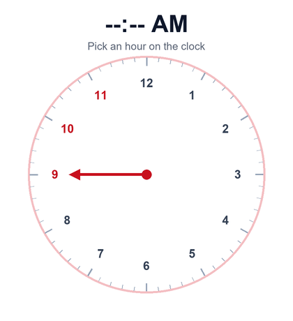
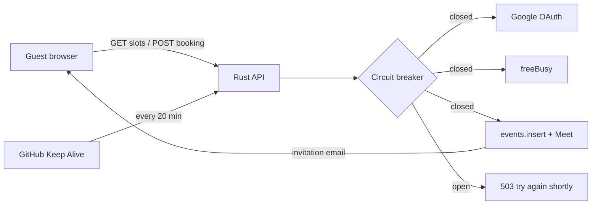
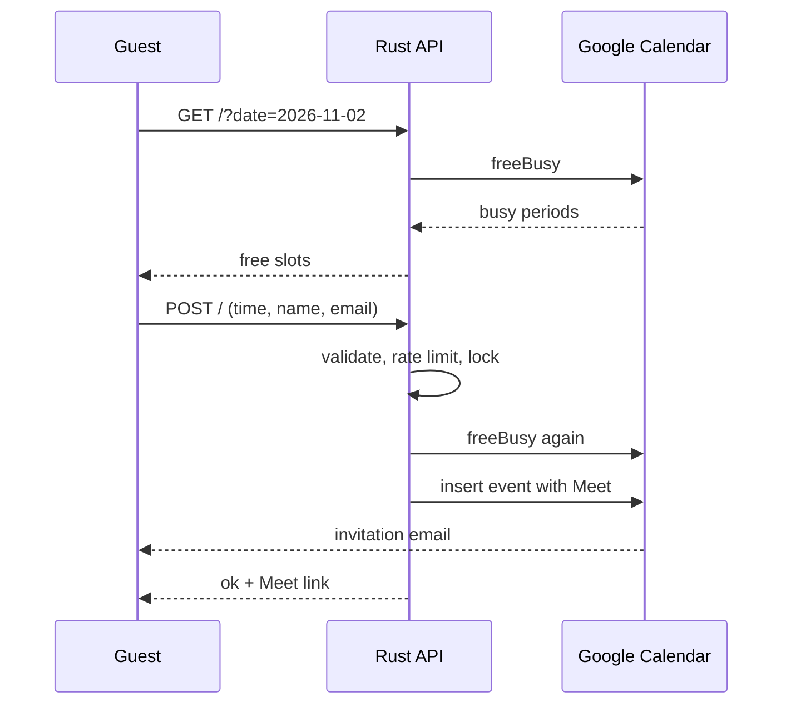

<p align="center"></p>
<p align="center"><b>A self-hosted, open-source alternative to Calendly for one person's calendar.</b></p>
<p align="center">


</p>
<p align="center"></p>
<p align="center"><a href="https://zubairhussain.xyz/book"><b>Try the interactive clock</b></a> · <a href="docs/SETUP.md">Setup</a> · <a href="docs/ARCHITECTURE.md">Architecture</a> · <a href="docs/TROUBLESHOOTING.md">Troubleshooting</a></p>

> Independent project. Not affiliated with or endorsed by Calendly. Calendly is a trademark of its owner.

## What is Calendly?

Calendly is a hosted scheduling service. You connect your calendar, share a link, and people book a free time. Paid plans add teams, routing, workflows and integrations.

## What this project does

The same core booking flow, on your own infrastructure and Google account.

| | Calendly | ZH Booking |
|---|---|---|
| Hosting | Run by Calendly | You host it |
| Your data | Passes through Calendly | Between you and Google; the service keeps no booking database |
| Price | Free and paid plans | Free software; you pay for any hosting |
| Design | Calendly's page | Your HTML, your brand |
| Time picking | Time-slot list | Interactive clock |
| Meet links and invites | Yes | Yes, via Google Calendar |
| Teams, routing, payments, reminders | Available | Not included |

## Features

- **Live availability** from Google Calendar freeBusy
- **Clock picker:** date, then hour, then minutes
- **Automatic invites** with a Google Meet link
- **Double-booking guard:** lock plus a fresh availability check
- **Tamper checks:** the server only accepts times it would offer
- **Rate limit:** 5 booking attempts per IP per hour
- **Circuit breaker:** fails fast during Google outages, then recovers
- **Keep Alive:** pings `/healthz` about every 20 minutes
- **Security automation:** cargo audit, gitleaks, Dependabot, Claude audit

## System architecture





## Run it

```bash
cp .env.example .env
cargo test
cargo run
```

Open `web/book.html`, set `API_URL` in its CONFIG, and follow [docs/SETUP.md](docs/SETUP.md) for Google setup and deployment.

## Status

Early project, not independently security audited. Test a real booking before relying on it.

## License

[MIT](LICENSE)
